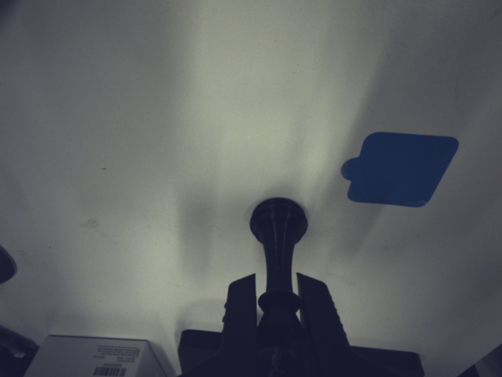
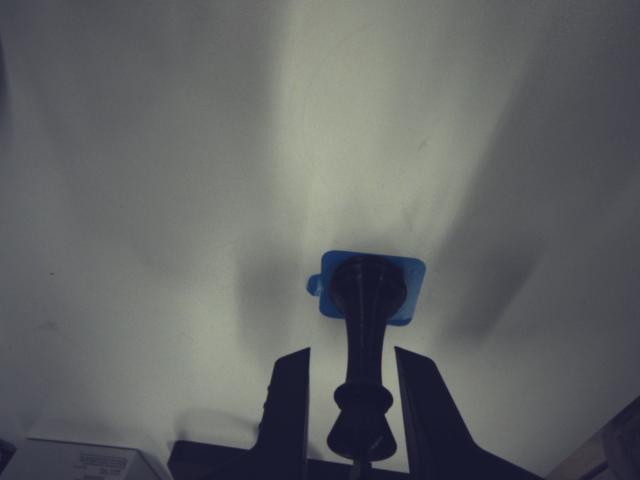
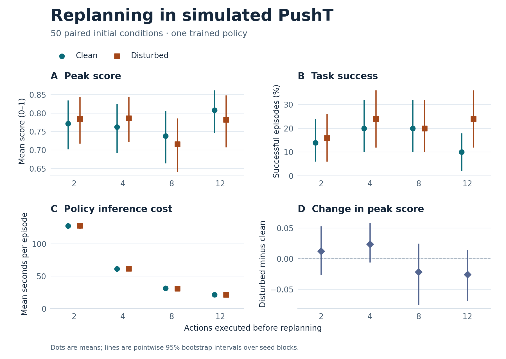

# Diffusion Policy on PushT: How Often Should We Replan?

**A reproduction of image-based Diffusion Policy and a paired evaluation of action execution length in simulated planar pushing.**

In PushT, a policy uses images and the pusher's position to move a T-shaped block into a target pose. It predicts a sequence of actions, executes the first few, then observes the scene again and replans. **How does the number of actions executed between replans affect task success, peak goal overlap, and inference cost?** This study holds one trained policy fixed and tests four execution lengths, with and without a timed disturbance, across the same 50 initial conditions (400 evaluation rollouts).

[Real-robot progress](#real-robot-reproduction-in-progress) · [Simulation results](#held-out-results) · [Protocol](#experimental-design) · [Raw data](results/horizons-test/episodes.csv) · [Rollout videos](results/horizons-test/videos/) · [Reproduction guide](docs/reproduction.md)

## Real-robot reproduction in progress

The B601 extension uses keyboard demonstrations of picking up a chess piece and placing it on a marked target. Data review, 100 full training epochs, offline action evaluation, and a five-configuration sampler comparison are complete. Of 40 complete formal recordings, 34 were retained for training and validation, split by episode into 30 training and four validation demonstrations. The policy uses two RGB observations and seven measured joint/gripper positions to predict absolute motor-degree targets.

The current candidate is the final EMA checkpoint with DDIM 10-step sampling. On 128 fixed validation windows and two sampling seeds, its normalized eight-action prediction MSE is 0.002625. Each sampler has 100 interleaved batch-one latency measurements on an RTX 4060 Laptop GPU:

| Sampler | Median inference | P95 inference | Normalized action MSE |
| --- | ---: | ---: | ---: |
| DDPM 100 steps | 0.935 s | 1.125 s | 0.002655 |
| DDIM 10 steps | 0.096 s | 0.196 s | 0.002625 |

These are offline command-prediction results on validation episodes also used for checkpoint selection. Gripper MAE increases by 2.01% overall and 9.45% in episode 30 when switching to the DDIM candidate. Camera/robot I/O is excluded from these timings, and physical closed-loop task success has not been measured. The next milestone is [predict-only integration, followed by controlled closed-loop evaluation](docs/reproduction.md#b601-next-steps).

See the [data audit](results/b601-data-check/summary.txt), [training and checkpoint validation](results/b601-seed42/validation.json), [action-prediction comparison](results/b601-seed42/evaluation/summary.txt), and [sampler benchmark](results/b601-seed42/sampler-benchmark/summary.txt). Raw recordings and model weights remain local; checked-in reports preserve settings, provenance, predictions, metrics, and hashes.

The [B601 collection guide](collection/b601/README.md) documents the keyboard controls, capture sequence and dataset schema, with links to the terminal recorder and macOS app.

| Initial position | During transfer | At the target |
| :---: | :---: | :---: |
|  |  |  |

*Camera frames 0, 309, and 649 from one teleoperated demonstration. The results below are from the PushT simulation.*

## Held-out results

**Longer execution chunks reduced inference cost, and the performance ranking depended on the metric.** In the clean condition, executing 12 actions per replan gave the highest mean peak score (0.808) and the lowest success count (5/50). Executing 4 or 8 actions reached the success threshold in 10/50 trials each. Mean cumulative policy inference time per clean episode fell from 127.3 s at 2 actions to 21.6 s at 12 actions, about one-sixth as much time.



*Figure 1. Each setting uses the same 50 initial conditions. Intervals are pointwise 95% percentile bootstrap intervals, resampling complete seed blocks. Panel D compares disturbed and clean trials within each seed.*

| Actions before replanning | Clean peak score | Clean success | Disturbed peak score | Disturbed success | Clean inference per episode |
| ---: | ---: | ---: | ---: | ---: | ---: |
| 2 | 0.772 | 7/50 (14%) | 0.784 | 8/50 (16%) | 127.3 s |
| 4 | 0.762 | 10/50 (20%) | 0.786 | 12/50 (24%) | 61.3 s |
| 8 | 0.738 | 10/50 (20%) | 0.716 | 10/50 (20%) | 31.8 s |
| 12 | 0.808 | 5/50 (10%) | 0.782 | 12/50 (24%) | 21.6 s |

The five-seed development sweep favored 8 actions on peak score in both scenarios. That ranking did not hold on the 50 held-out seeds. All four paired intervals for the disturbed-minus-clean change in peak score span zero. The 12-action setting showed a higher observed success rate under disturbance (+14 percentage points; pointwise 95% interval +2 to +26), an exploratory result for this checkpoint and this particular impulse. See the [analysis notes](results/README.md#paired-analysis) for the full contrasts and uncertainty.

## Experimental design

This project adapts the [published image-based CNN configuration](configs/baseline.yaml) from [Chi et al., *Diffusion Policy* (RSS 2023)](https://diffusion-policy.cs.columbia.edu/). The authors studied the action horizon in [§4.3 of their paper](https://arxiv.org/html/2303.04137v5); this repository examines it in a smaller PushT model under a fixed, paired disturbance protocol. The repo provides the [training profile](configs/rtx4060_laptop.yaml), [paired evaluator](scripts/evaluate_horizons.py), and [analysis code](scripts/analyze_horizons.py).

| Design choice | Protocol |
| --- | --- |
| Fixed policy | RTX 4060 Laptop profile with reduced U-Net widths; one training seed (42). The epoch-100 EMA checkpoint was selected from five saved evaluations on a separate set of 50 seeds. Its selection score was 0.7913. |
| Execution length | Execute 2, 4, 8, or 12 actions before replanning. Keep the two-observation history, 16-action prediction horizon, and 100 denoising steps fixed. |
| Disturbance | Apply a +X velocity kick of 120 simulation units/s to the block immediately before control step 50, if the episode is still active. Rollouts run for up to 300 control steps. |
| Seed separation | Checkpoint selection: `100000–100049`. Development: `200000–200004`. Held-out evaluation: `300000–300049`. Each held-out environment seed and its corresponding diffusion sampling seed are reused across all eight settings. |

**Metrics.** Peak score is the highest block–goal overlap in an episode, divided by 0.95 and clipped to 1, then averaged across episodes. Binary success requires raw overlap strictly above 95%. The disturbed column includes all 50 trials assigned to that scenario. At 8 actions, one trial succeeded before the disturbance trigger, leaving **9/49** successes among exposed trials versus **10/50** overall. Inference time sums the durations of policy calls and associated data transfers; the simulator pauses during inference.

**Scope.** This evaluates a reduced model trained once and tested against one disturbance direction, magnitude, and trigger. The kick can arrive at different positions within an action chunk. Peak score can reflect overlap reached before the kick. The intervals describe variation across initial conditions for this checkpoint and are unadjusted for multiple comparisons. The simulation does not establish performance on real robots or the effects of real-time inference delay.

A follow-up would repeat the sweep across independently trained policies and vary when the kick lands within the action chunk, to distinguish sensitivity to the checkpoint from sensitivity to disturbance timing.

## Reproduce the analysis

The tables and figure can be regenerated from the checked-in CSV and protocol with Python 3.11. The analysis requires neither a GPU nor model weights.

```bash
python -m pip install -r requirements-analysis.txt
python scripts/analyze_horizons.py
```

| Artifact | Where to look |
| --- | --- |
| Held-out run | [Protocol and checkpoint hash](results/horizons-test/protocol.json) · [400 episode records](results/horizons-test/episodes.csv) · [condition estimates](results/horizons-test/analysis/condition_estimates.csv) · [paired contrasts](results/horizons-test/analysis/paired_disturbance_effects.csv) |
| Rollouts and provenance | [Clean videos](results/horizons-test/videos/clean/) · [disturbed videos](results/horizons-test/videos/disturbed/) · [validation](results/horizons-test/validation.json) · [artifact checksums](results/horizons-test/manifest.json) |
| Training and development | [Training archive](results/rtx4060-seed42/README.md) · [development sweep](results/README.md#action-execution-length-development-sweep) |
| Rerun the experiments | [Setup, data preparation, training, and rollout commands](docs/reproduction.md). The archived model weights are held locally; rerunning those exact rollouts requires access to the checkpoint. |

The [upstream implementation](https://github.com/real-stanford/diffusion_policy/tree/5ba07ac6661db573af695b419a7947ecb704690f) and the original PushT data are credited to their authors. See the repository [license](LICENSE).
