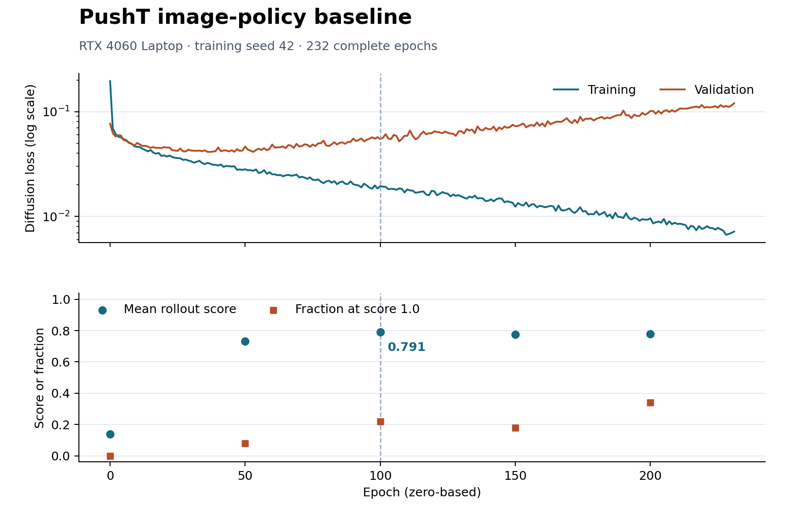

# Results

The checkpoint evaluator writes `eval_log.json` and rollout videos to a new directory. The action execution study writes its protocol, per-episode CSV, summary CSV, and optional videos. The GPU smoke test writes a JSON file containing CUDA compatibility, memory, and timing measurements. Selected completed experiment outputs are committed through explicit `.gitignore` exceptions. Large checkpoints remain local and are not uploaded.

[`rtx4060-validation.json`](rtx4060-validation.json) records the WSL 2 RTX 4060 Laptop smoke test and short training validation. Paths in that report refer to the original artifact locations. This short run is a functional check with four 32-step test episodes, not a converged policy or the full benchmark. When reporting a benchmark, record the training seed, configuration, checkpoint, and `test/mean_score` across the 50 published test seeds.

The [RTX 4060 seed-42 experiment archive](rtx4060-seed42/README.md) preserves the subsequent longer run, all raw training metrics, configurations, 33 videos across validation and training, per-episode evaluation results, stop status, and local checkpoint metadata/checksums. Small artifacts referenced by the earlier validation report are also committed. Model checkpoints from both runs remain local.

## RTX 4060 baseline analysis



The [rollout summary](rtx4060-seed42/analysis/rollout_summary.csv) aggregates the 250 archived scores. The [paired scores](rtx4060-seed42/analysis/paired_episode_scores.csv) align all five evaluations by test seed and give the epoch 200 minus epoch 100 score for each initial condition.

Epoch 100 has the highest mean score (0.7913). At epoch 200, 27 seeds improved, 16 declined, and 7 tied. The number of scores at 1.0 rose from 11 to 17, while the mean fell to 0.7772. Seed 100044 fell from 0.9902 to zero and seed 100024 fell from 0.7003 to 0.0536. The archive records each episode's maximum clipped normalized coverage. Exact raw coverage above the clipping threshold and time to success require a new evaluation.

Regenerate the figure and tables from the repository root in the activated environment:

```bash
python -m pip install -r requirements-analysis.txt
python scripts/analyze_baseline.py
```
